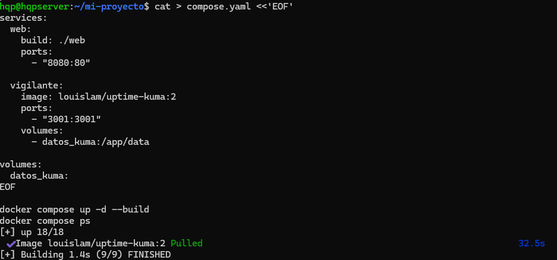
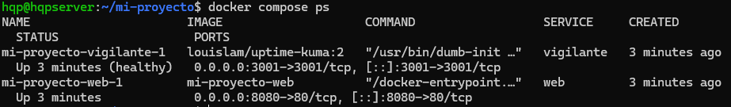
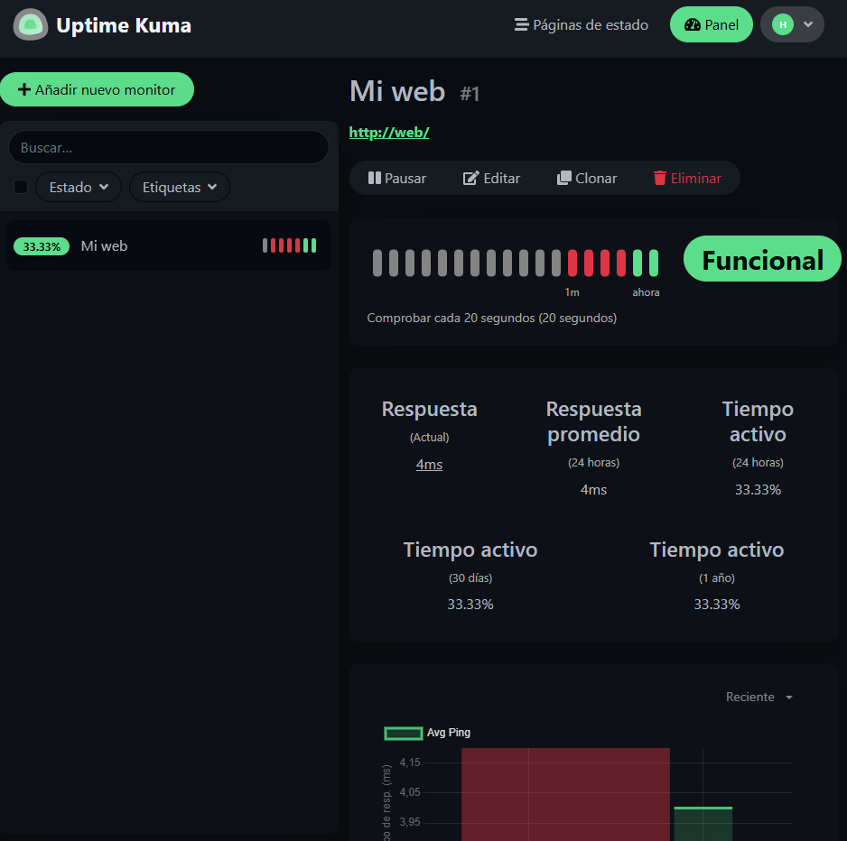
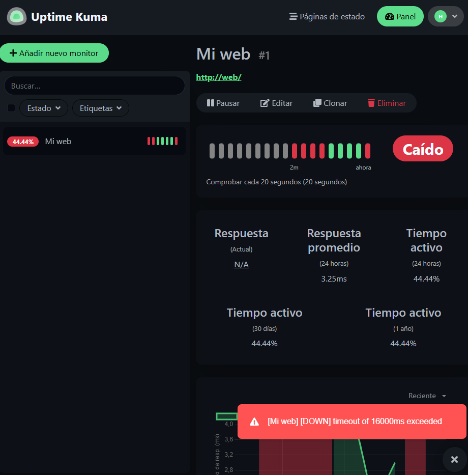
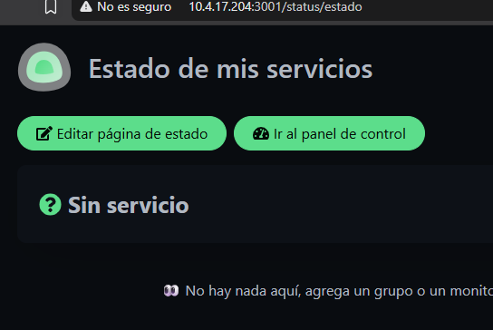
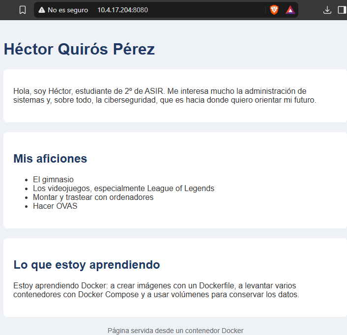
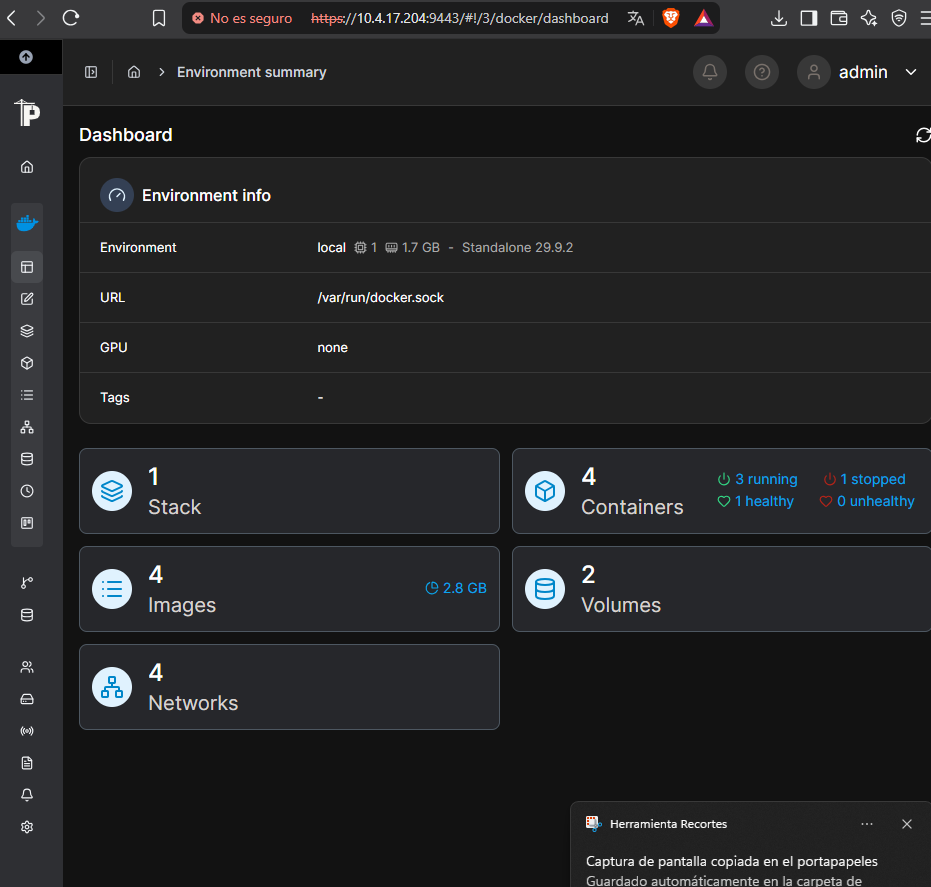
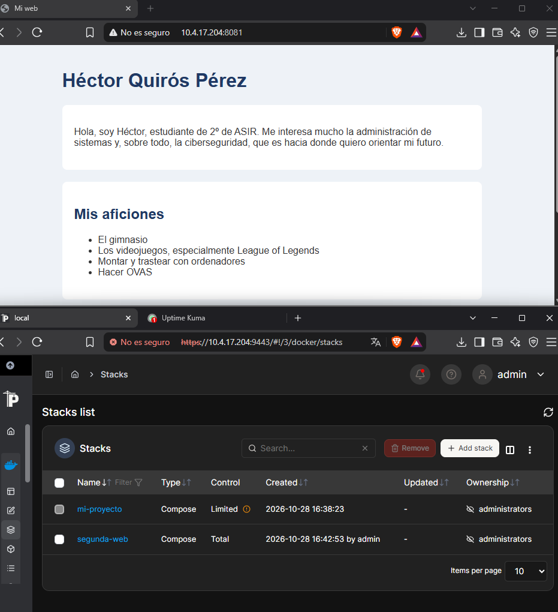

# Web en Docker con monitorización (Uptime Kuma) y gestión con Portainer

Despliegue de una web en un contenedor Nginx, vigilada por **Uptime Kuma**, todo orquestado con **Docker Compose** en un Ubuntu Server virtualizado. Como ampliación, el entorno se administra también desde **Portainer**.

Práctica de *Administración de Sistemas Operativos* (2º ASIR).

## Arquitectura

```
Windows (anfitrión) ── SSH / navegador ──> Ubuntu Server (VirtualBox, adaptador puente)
                                              │
                                              └── Docker Engine
                                                    ├── web        nginx:alpine (imagen propia)   :8080 -> 80
                                                    ├── vigilante  louislam/uptime-kuma:2         :3001 -> 3001  (volumen datos_kuma)
                                                    ├── portainer  portainer/portainer-ce:lts     :9443
                                                    └── web2       stack creado desde Portainer   :8081 -> 80
```

Uptime Kuma comprueba la web por el nombre del servicio (`http://web`), usando la red interna que crea Docker Compose.

## Qué se ha hecho

1. Instalación de Docker Engine y Docker Compose desde el repositorio oficial en Ubuntu Server.
2. Imagen propia de la web con un `Dockerfile` basado en `nginx:alpine`.
3. `compose.yaml` con dos servicios: la web y el vigilante, con un volumen para que Uptime Kuma conserve su configuración.
4. Monitor HTTP en Uptime Kuma y prueba de caída: al parar la web el panel la marca como caída y al arrancarla vuelve a verde.
5. Página de estado pública en `/status/estado`.
6. Cambios en la web con reconstrucción de la imagen y comprobación de la persistencia del volumen tras recrear los contenedores.
7. **Ampliación con Portainer**: visualización de contenedores, logs, consola, prueba de caída desde la interfaz y despliegue de un nuevo stack (`segunda-web`) desde el editor web.

## Estructura

```
.
├── compose.yaml              # Servicios web y vigilante
├── web/
│   ├── Dockerfile            # FROM nginx:alpine + COPY de la web
│   └── index.html            # Página servida por el contenedor
├── portainer/
│   └── segunda-web.yaml      # Stack desplegado desde Portainer
└── capturas/                 # Evidencias de cada fase
```

## Cómo levantarlo

```bash
docker compose up -d --build
docker compose ps
```

- Web: `http://IP_DEL_SERVIDOR:8080`
- Uptime Kuma: `http://IP_DEL_SERVIDOR:3001` (en el monitor, URL `http://web`)

Portainer:

```bash
docker volume create portainer_data
docker run -d -p 9443:9443 --name portainer --restart=always \
  -v /var/run/docker.sock:/var/run/docker.sock \
  -v portainer_data:/data \
  portainer/portainer-ce:lts
```

Acceso en `https://IP_DEL_SERVIDOR:9443`. El token de instalación se obtiene con `docker logs portainer 2>&1 | grep -i token`.

## Problemas encontrados y solución

| Problema | Causa | Solución |
|---|---|---|
| `apt` rechazaba los repositorios por fechas «no válidas todavía» | El reloj de la VM iba unos seis días atrasado | Corregir la hora con `timedatectl` |
| El monitor aparecía como caído | Puse `https://web` y Nginx solo sirve HTTP en el puerto 80 | Usar `http://web` |
| Portainer: «Unable to retrieve image: No such image» al abrir la consola | El contenedor seguía usando una imagen anterior ya reconstruida | `docker compose up -d --force-recreate web` |

## Evidencias

| | |
|---|---|
|  |  |
| `compose.yaml` y arranque del proyecto | Contenedores en marcha |
|  |  |
| Monitor en verde | Web parada: el monitor la detecta como caída |
|  |  |
| Página de estado pública | Web servida desde el contenedor |
|  |  |
| Dashboard de Portainer | Stacks `mi-proyecto` y `segunda-web` |

El resto de capturas están en [`capturas/`](capturas/).

## Conclusión

Docker Compose y Portainer se complementan: Compose deja el entorno descrito en un archivo que se puede versionar y reproducir, y Portainer facilita supervisar contenedores, consultar logs y hacer operaciones rápidas desde el navegador, usando el mismo motor de Docker a través de `docker.sock`.
